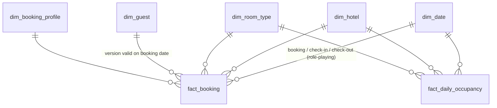

# Hotel Dimensional Model (SQL)


A Kimball-style star schema for a six-hotel chain, written in **plain SQL** and run on **DuckDB**. It turns raw property-management extracts into a tested warehouse that answers the questions hotel revenue teams ask every day: occupancy, ADR, RevPAR, cancellations, channel mix, and loyalty value.

There is no Spark here on purpose. This project is about **data modeling and SQL**: choosing grains, designing dimensions, handling history, and proving the numbers reconcile.

## Model



| Table | Type | Grain / purpose |
|---|---|---|
| `fact_booking` | Transaction fact | One row per booking. Measures: room nights, nightly rate, lead time, realized revenue, booked value |
| `fact_daily_occupancy` | Periodic snapshot fact | One row per hotel × room type × night, **including nights with zero sales**, so occupancy averages are correct |
| `dim_guest` | **SCD Type 2** | New version when home city or loyalty tier changes; name/email changes overwrite in place (Type 1) |
| `dim_date` | Conformed, role-playing | Used three times by `fact_booking` (booking, check-in, check-out) |
| `dim_booking_profile` | Junk dimension | Channel × rate plan × status combined into one small dimension |
| `dim_hotel`, `dim_room_type` | Type 1 | Surrogate keys plus an **Unknown member (key -1)** so facts never hold NULL keys |

### Design decisions

- **Two facts, two grains.** Bookings and nightly occupancy answer different questions. Mixing them in one table would double-count revenue or lose empty nights.
- **Point-in-time guest lookup.** Each booking joins to the guest version valid *on the booking date*, so "revenue by loyalty tier" reflects the tier the guest had when they booked, not their tier today.
- **Hash-based change detection.** Only tracked attributes go into the row hash, so a corrected email address doesn't create a fake new version.
- **Initial load history.** Guests in the first snapshot get `valid_from = 1900-01-01`, so bookings made before the first extract still find a guest row.

## Data marts

| View | What it answers |
|---|---|
| `mart.hotel_monthly_kpis` | Occupancy, ADR, and RevPAR by hotel and month |
| `mart.hotel_revpar_trend` | Month-over-month RevPAR change (window functions) |
| `mart.cancellation_by_lead_time` | Cancellation rate by channel and lead-time bucket |
| `mart.channel_mix` | Revenue share by booking channel |
| `mart.revenue_by_loyalty_tier` | Value per guest by tier at booking time (uses SCD2) |
| `mart.repeat_guest_rate` | Share of guests with 2+ stays per hotel |

## Results from a full build

32,000 bookings, 6,120 guests (6,300 SCD2 rows after 180 guests changed tier or city), 8,760 occupancy rows.

| Hotel | Occupancy | ADR | RevPAR |
|---|---:|---:|---:|
| Lakeshore Chicago | 58.7% | $247.33 | $145.23 |
| Uptown Austin | 68.5% | $177.26 | $121.42 |
| Riverside Dallas | 69.7% | $174.11 | $121.32 |
| Mile High Denver | 72.4% | $135.20 | $97.88 |
| Bayfront Houston | 60.3% | $139.56 | $84.09 |
| Desert Phoenix | 63.4% | $106.15 | $67.34 |

The data is synthetic but generated with realistic behavior: seasonality, weekend pricing, rate-plan discounts, and higher cancellation rates for longer lead times and OTA bookings. Room capacity is enforced, so occupancy never exceeds 100%.

## Tests

16 data tests run in CI on every push:

- **Grain:** one fact row per booking; one occupancy row per hotel × room type × night
- **Integrity:** every foreign key resolves; no fact row falls back to an Unknown member; the date dimension has no gaps
- **SCD Type 2:** one current row per guest; versions never overlap or leave gaps; exactly the 180 changed guests get a second version; email-only changes don't create versions; every booking points to the version valid on its booking date
- **Reconciliation:** stayed revenue and room nights match exactly between the two fact tables; cancelled bookings carry no revenue; RevPAR = ADR × occupancy; cancellation rate rises with lead time

## Run it

```bash
pip install -r requirements.txt
PYTHONPATH=src python -m hotel_dw.build        # builds hotel_dw.duckdb and prints KPIs
pytest                                          # runs the data tests
```

On Windows PowerShell, set the path first: `$env:PYTHONPATH="src"`.

Query the result with the DuckDB CLI or Python:

```sql
SELECT hotel_name, year_month, occupancy_rate, adr, revpar
FROM mart.hotel_monthly_kpis
ORDER BY revpar DESC
LIMIT 10;
```

## Project layout

```
sql/
  01_raw.sql                     land CSV extracts
  02_dim_date.sql                conformed date dimension
  03_dim_hotel_room_type.sql     Type 1 dimensions + Unknown members
  04_dim_booking_profile.sql     junk dimension
  05_dim_guest_scd2.sql          SCD2 table definition
  05b_guest_scd2_load.sql        SCD2 load: expire, overwrite Type 1, insert new versions
  06_fact_booking.sql            transaction fact with point-in-time guest lookup
  07_fact_daily_occupancy.sql    periodic snapshot fact
  08_marts.sql                   business views
src/hotel_dw/
  generate_data.py               deterministic sample data
  build.py                       runs the scripts in order
tests/                           grain, integrity, SCD2, and reconciliation tests
```

## Tech

SQL · DuckDB · Kimball dimensional modeling · SCD Type 2 · Window functions · Python · pytest · GitHub Actions
